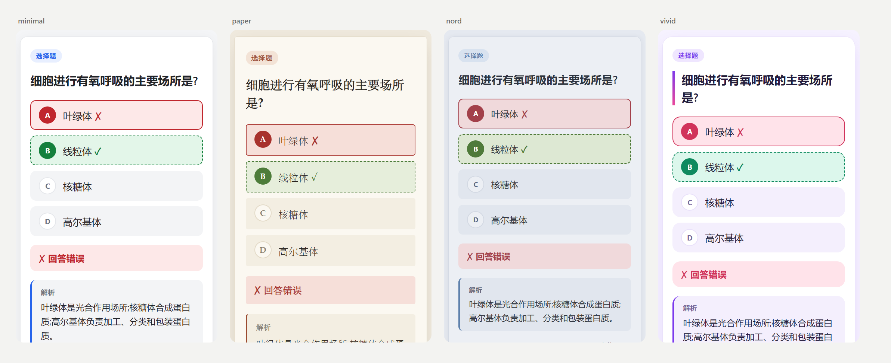
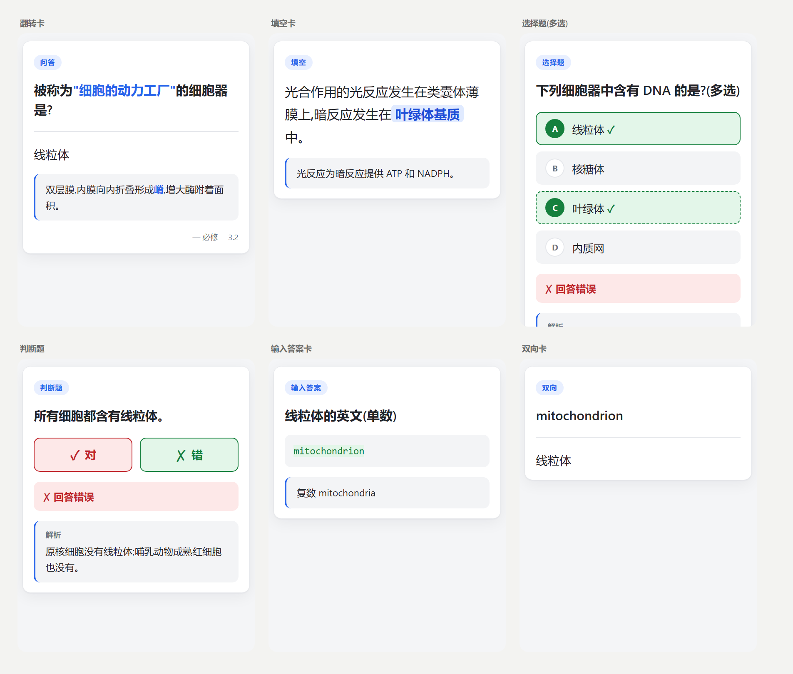
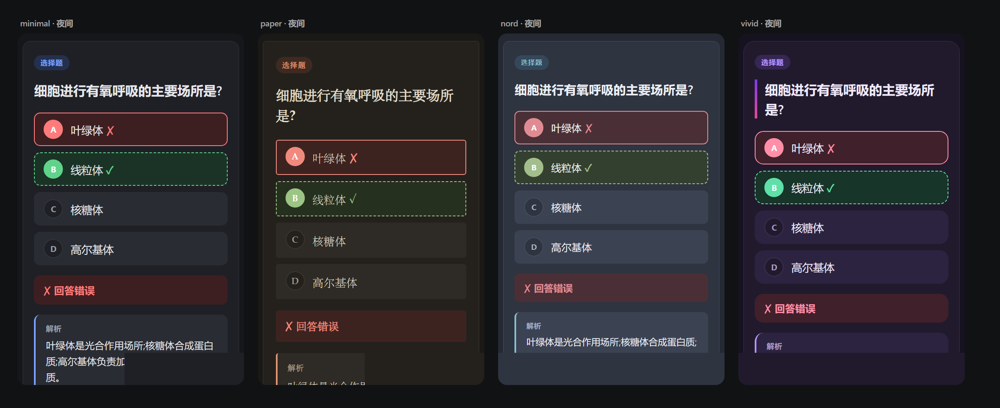

# Anki Deck Builder

> 一个 Claude Skill:把任何学习材料变成好看、好用、可以随时改的 Anki 卡包。
>
> *A Claude skill that turns any study material — PDF, Word, PowerPoint, web pages, videos — into a polished Anki deck you can restyle or re-type later without losing review history.*

把一份 PPT、一章教材、一个网页或者一段课程视频交给 Claude,告诉它你想要什么题型和风格,它会提炼知识点、出题、套上设计好的卡片模板,最后打包成可以直接导入 Anki 的 `.apkg`。



## 特性

- **什么材料都能用**:PDF、Word(.docx)、PPT(.pptx,包括演讲者备注)、txt/Markdown、网页链接、epub、字幕(.srt/.vtt)、YouTube/B 站视频、本地音视频(用 whisper 转写)、图片。
- **六种卡片类型**:翻转卡、双向卡、填空卡(cloze)、选择题(单选/多选)、判断题、输入答案卡。选择题和判断题可以**直接点击作答**,翻面后标出对错和漏选。
- **认真设计的样式**:四个内置主题,每个都有日间/夜间两套配色,适配手机。正确/错误除了颜色还有 ✓/✗ 符号。
- **出题有讲究**:选择题的干扰项来自真正容易混淆的概念;判断题的错误陈述来自常见误解;每道题都附解析;构建时会检查正确答案是否集中在同一个字母。
- **保留设计过程,随时可以改**:材料、知识点、卡片、样式分层存放在一个项目文件夹里。之后想换风格、加题型、改题目,带着文件夹回来就行。**重新导入会更新原有卡片,复习记录不会丢**。
- **可以接入其他设计 skill**:样式通过一组 CSS 设计变量控制,任何能输出 CSS 的设计类 skill 都能给整套卡片换装。



<details>
<summary>夜间模式</summary>



</details>

## 安装

### Claude Code

把仓库克隆到 Claude Code 的 skills 目录:

```bash
git clone https://github.com/Mran/anki-deck-builder.git ~/.claude/skills/anki-deck-builder
```

Windows 下路径是 `%USERPROFILE%\.claude\skills\anki-deck-builder`。也可以克隆到某个项目的 `.claude/skills/` 下,只在那个项目里启用。

### Claude.ai / Claude 桌面应用

把仓库打包成 zip(zip 里的顶层是 `anki-deck-builder/` 文件夹),在 设置 → Capabilities → Skills 中上传。

### Python 依赖

脚本需要 Python 3.9+:

```bash
pip install -r requirements.txt
```

`genanki` 和 `pyyaml` 是必需的。其余依赖只在处理对应格式的材料时才用到,缺少时脚本会提示安装命令:

| 材料 | 依赖 |
|---|---|
| PDF | `pypdf`(提取图片需 `pymupdf`) |
| Word / PPT | `python-docx` / `python-pptx` |
| 网页 / epub | `beautifulsoup4`(可选 `trafilatura` 效果更好) |
| YouTube / B 站 | `yt-dlp` |
| 本地音视频 | `ffmpeg` + `faster-whisper` |

## 使用方法

装好之后,直接用自然语言告诉 Claude 你要什么。它会在需要时自动调用这个 skill。

**从材料生成卡包**

```
把 lecture3.pptx 做成 anki 卡包,要翻转卡和选择题,选择题多一点,我要刷题备考。
```

```
这是我的唐朝复习笔记 tang.txt,做成填空和判断题,风格要古书那种纸张质感。
```

```
https://www.youtube.com/watch?v=xxxx 这个视频讲的内容帮我做成 anki 卡片
```

没说清楚的地方(题型、风格、覆盖范围),Claude 会根据材料给出推荐并一次问完。

**之后修改**

```
把「农业信息学」这个卡包换成暗色赛博朋克风格,霓虹青加品红。
```

```
给 cell-biology 项目里每个翻转卡的知识点再加一道判断题,别把复习记录弄丢。
```

```
用我们公司的设计系统 skill 给这套卡片重新设计样式。
```

**导入 Anki**

在 Anki 中选择 文件 → 导入,选中生成的 `.apkg`。以后更新卡包重新导入时,在导入选项里把「更新笔记类型」设为「如果更新则更新」(Anki 23.10+)。已有卡片会原地更新,复习进度保留。

## 工作原理

```
材料 ──ingest──▶ sources/*.md ──提炼──▶ knowledge.yaml ──出题──▶ cards.yaml ──build──▶ .apkg
                                          (知识点,与题型无关)    (题型 + 字段)      + preview.html
                                                                      ▲
                                                 style/theme.css ─────┘
```

每个卡包是一个项目文件夹:

```
我的卡包/
├── project.yaml        # 名称、uid(决定所有卡片 ID,永远不要改)、语言、主题
├── DESIGN_LOG.md       # 每次修改的原因
├── sources/            # 材料转换后的 markdown
├── media/              # 图片、字体
├── knowledge.yaml      # 知识点,带易混概念和常见误解
├── cards.yaml          # 卡片,也可以拆成 cards/*.yaml
├── style/
│   ├── theme.css       # 设计变量
│   ├── overrides.css   # 结构性样式调整
│   └── brief.md        # 风格需求和设计意图
└── build/
    ├── <名称>.apkg
    ├── preview.html    # 浏览器预览:日/夜切换,正面可点击
    └── history.jsonl   # 每次构建的记录
```

为什么分这么多层?因为最常见的后续需求是「换个风格」和「换个题型」:

- **换风格**只改 `style/`,卡片内容不动。
- **换题型**从 `knowledge.yaml` 重新出题,而不是把旧卡片硬转。比如翻转卡变选择题需要干扰项,这些干扰项来自知识点里记录的易混概念。
- **卡片 ID 和笔记类型 ID 都由项目 `uid` 确定性地算出来**,所以重新构建、重新导入时 Anki 认得出是同一张卡。

## 卡片类型

| `type` | 名称 | 必填字段 | 说明 |
|---|---|---|---|
| `basic` | 翻转卡 | Front, Back | 可选 Extra(解释)、Source(出处) |
| `reversed` | 双向卡 | Front, Back | 正反两张卡,适合单词 ↔ 释义 |
| `cloze` | 填空卡 | Text | `{{c1::答案}}` 或 `{{c1::答案::提示}}` |
| `mcq` | 选择题 | Question, Options, Answer | `Answer: B` 或 `A,C`(多选);可选 `Shuffle: true` |
| `truefalse` | 判断题 | Statement, Answer | `Answer: true / false` |
| `typein` | 输入答案卡 | Front, Answer | Anki 原生逐字比对 |

完整的写法规范见 [references/card-types.md](references/card-types.md)。

## 样式

| 主题 | 风格 | 适合 |
|---|---|---|
| `minimal` | 白底蓝调,干净中性 | 任何学科,定制的起点 |
| `paper` | 暖米色纸张、衬线字体 | 文史、语言、阅读 |
| `nord` | 北欧蓝灰,夜间优先 | 编程、理工科、长时间复习 |
| `vivid` | 紫粉渐变、大圆角 | 语言学习、轻松复习 |

除了内置主题,还可以直接描述想要的风格(「手账风」「像 Notion 一样」),或者让其他设计类 skill 来做。所有题型共用一套 [CSS 设计变量](references/styling.md#2-设计变量契约),只要满足这份约定,就能给全部卡片换装。

文档里也记录了 Anki 渲染环境的各种坑:各客户端夜间模式的类名不同、离线时网络字体加载失败、桌面端会重复执行卡片脚本等。

## 脚本

skill 会自己调用这些脚本,也可以手动用:

```bash
# 新建项目 / 切换主题(旧样式自动备份到 style/history/)
python scripts/project.py init 我的卡包 --name "我的卡包" --theme minimal --lang zh
python scripts/project.py set-theme 我的卡包 paper
python scripts/project.py list-themes

# 导入材料
python scripts/ingest.py 讲义.pdf 课件.pptx https://example.com/article --project 我的卡包

# 校验 + 打包 + 生成预览
python scripts/build.py 我的卡包
python scripts/build.py 我的卡包 --check        # 只校验

# 装了 AnkiConnect 插件时,直接把新样式推进 Anki,不用重新导入
python scripts/anki_connect.py push-style 我的卡包
```

`build.py` 会校验必填字段、填空语法、选择题答案是否越界、ID 是否重复;还会对质量问题给出警告,比如选择题正确答案扎堆在同一个字母、判断题对错比例失衡。

## 示例与测试

- [`examples/cell-biology/`](examples/cell-biology/):覆盖全部六种题型的小型示例项目。
- [`evals/`](evals/):三个测试用例,包括 PPT 转选择题、笔记转填空和判断题(书卷风),以及在保留复习记录的前提下给已有项目换风格并加题。可以用 `claude plugin eval` 运行。

## 已知限制

- 预览页是近似渲染,最终效果以 Anki 为准。卡片已按桌面版、AnkiDroid、AnkiMobile 的差异设计,但没有在每个客户端上逐一实测。
- 选择题打乱选项和点击作答依赖卡片里的 JavaScript。禁用脚本的客户端会按原始顺序显示选项,背面直接标出正确答案。
- 改变已有卡片的题型等于新建卡片,原卡的复习记录不会迁移。脚本也不会删除 Anki 里的任何数据。
- 扫描版 PDF 需要 OCR 或视觉读取;需要登录的网页需要用浏览器工具读取。

## License

[MIT](LICENSE)
